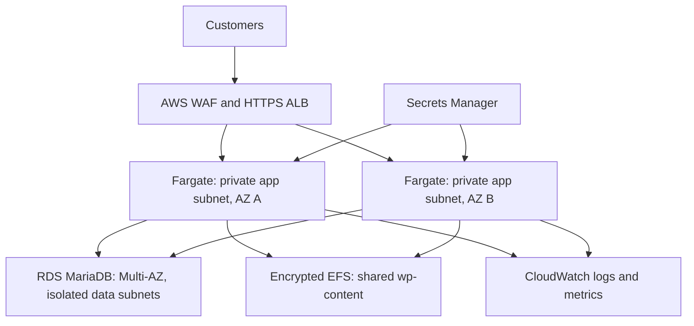

# AWS Cloud Platform Modernization

**Terraform infrastructure for a customer-facing WordPress platform, with security controls, multi-AZ architecture, and automated delivery.**

[](https://github.com/Monkmode-tech/aws-cloud-platform-modernization/actions/workflows/ci.yml)

**Author:** [Caleb Tetteh](https://github.com/Monkmode-tech)  
**Focus:** Cloud Engineering · Cloud Security · Solutions Architecture  
**Stack:** AWS · Terraform · Python · GitHub Actions · ECS Fargate · RDS MariaDB · EFS

This project takes a WordPress cloud lab through the engineering decisions needed for a growing company's website: isolate the application and database, preserve content across replicas, protect credentials, control deployments, and measure service behavior before making capacity claims.

**Current status:** Reference implementation with 12 passing offline Python tests. Live AWS deployment, performance measurements, and recovery validation are pending. Terraform provider validation and mocked profile tests are included in CI; see the [validation record](docs/local-validation.md) and workflow results above.

**Explore:** [Architecture decisions](docs/architecture-decisions.md) · [Security review](docs/security-review.md) · [CI/CD](docs/ci-cd.md) · [Evidence](evidence/README.md) · [Deployment guide](docs/deployment-runbook.md)

## The business problem

A fictional company relies on WordPress for its public website. Traffic spikes, inconsistent uploaded files across containers, broad access permissions, and ad hoc recovery can turn routine growth into service interruptions.

The objective is a reproducible platform with a practical progression from affordable experiments to a company-oriented deployment. Cost, security, availability, and operational trade-offs are explicit throughout the implementation.

## Engineering capabilities

| Role | What this project demonstrates | Inspect the implementation |
|---|---|---|
| **Cloud Engineer** | Infrastructure as code, container orchestration, persistent storage, bounded autoscaling, monitoring, and operational automation | [Terraform](infra/), [load validation](scripts/validate_live.py), [task recovery](scripts/recovery_drill.py) |
| **Cloud Security Engineer** | Network segmentation, scoped IAM, restricted database credentials, secret injection, HTTPS entry, and WAF configuration | [Network controls](infra/network.tf), [IAM](infra/iam.tf), [database bootstrap](scripts/bootstrap_db.py), [security findings](docs/security-review.md) |
| **Solutions Architect** | Multi-AZ design, cost/availability trade-offs, staged initialization, failure boundaries, and readiness criteria | [Architecture decisions](docs/architecture-decisions.md), [cost planning](costs/README.md), [business readiness](docs/business-readiness.md) |

## Business architecture



The business profile spans two Availability Zones in one region. Each private application subnet uses a NAT gateway in its own AZ. WordPress core comes from a digest-pinned image; EFS persists media, plugins, and themes. Shared authentication keys support sessions across replicas.

### Two profiles, one codebase

| Design choice | `lab` — economical testing | `business` — company-oriented target |
|---|---|---|
| Application baseline after setup | 1 task; optional scaling to 2 | 2 tasks; scaling from 2 to 10 |
| Application network | Public task IPs; inbound traffic only from ALB | Private app subnets across two AZs |
| Outbound connectivity | No NAT gateway | One NAT gateway per AZ |
| Database | Private, encrypted Single-AZ MariaDB | Private, encrypted Multi-AZ MariaDB |
| Persistent content | Encrypted EFS | Encrypted EFS with automatic backups |
| Public entry point | Workstation `/32`; HTTPS or explicit disposable HTTP mode | Public HTTPS with ACM and AWS WAF |
| Database retention | 1-day backup retention | 7-day retention, final snapshot, deletion protection |

These are configuration limits, not measured customer capacity. Rolling deployments can temporarily exceed the steady-state task limit.

## Decisions that matter

- **Separate network trust boundaries.** ALB, application, database, and filesystem security groups constrain access by tier. The data subnets have no internet routes.
- **Keep the master database account out of the application.** A one-off task creates a user restricted to the WordPress database. Normal application tasks receive only that user's secret.
- **Share the right state.** Persist `wp-content` on EFS while keeping WordPress core tied to the image. Initialize one task before enabling replicas.
- **Control delivery without stored AWS access keys.** GitHub Actions uses OIDC, exact repository/environment trust, and a service-scoped deployment role. Image changes pass CI before a manually dispatched rollout.
- **Verify rollback behavior.** The deployment script checks that the requested revision became active; an ECS rollback is reported as a failed deployment.
- **Preserve the business target while limiting test costs.** The lab supports short sessions and teardown. The business profile retains private compute, per-AZ outbound connectivity, and a standby database.

Read the rationale and trade-offs in [architecture decisions](docs/architecture-decisions.md).

## Validation and evidence

| Evidence | Status | Details |
|---|---|---|
| Python guardrails and infrastructure policy tests | **12 passed locally** | [Tests](tests/) cover deployment restrictions, recovery safeguards, request errors, encryption, and network/IAM invariants |
| Terraform formatting, HCL/YAML parsing, Python compilation, basic secret scan | **Passed locally** | [Validation record](docs/local-validation.md) |
| Terraform provider validation and mocked profile tests | **CI configured; local execution blocked** | The build environment prohibited the provider's local socket; see [workflow results](https://github.com/Monkmode-tech/aws-cloud-platform-modernization/actions/workflows/ci.yml) |
| Live provisioning, scaling, delivery, and task recovery | **Pending** | [Runbook](docs/deployment-runbook.md) and [evidence template](evidence/validation-template.md) |
| Database/filesystem restore and customer-capacity tests | **Pending** | [Business acceptance criteria](docs/business-readiness.md) |

The original coursework includes an ALB outage/restoration exercise and explicitly simulated scaling results. The [source-to-evidence mapping](evidence/README.md) distinguishes these from this revised implementation. A task restart does not establish regional disaster recovery or a recovery point objective.

## Run the project

Start with checks that create no AWS resources:

```bash
git clone https://github.com/Monkmode-tech/aws-cloud-platform-modernization.git
cd aws-cloud-platform-modernization
python -m pip install -r requirements-dev.txt
terraform -chdir=infra init -backend=false
terraform -chdir=infra fmt -check -recursive
terraform -chdir=infra validate
terraform -chdir=infra test
python -m pytest -q
python scripts/check_secrets.py
```

The [deployment runbook](docs/deployment-runbook.md) covers cost review, provisioning, credential initialization, WordPress setup, scaling, evidence collection, and teardown. AWS resources incur charges; review the [cost and cleanup guidance](costs/README.md) before applying either profile. Never commit credentials, state, plans, or unreviewed screenshots.

## Repository guide

| Path | Purpose |
|---|---|
| [`infra/`](infra/) | Terraform, provider lock file, and mocked profile tests |
| [`app/`](app/) | Approved image digest and update guidance |
| [`scripts/`](scripts/) | Database bootstrap, delivery, validation, and recovery automation |
| [`.github/workflows/`](.github/workflows/) | CI and protected manual deployment |
| [`tests/`](tests/) | Offline safety and security-policy tests |
| [`docs/`](docs/) | Architecture, security, operations, and readiness decisions |
| [`evidence/`](evidence/) | Claim provenance and live validation template |
| [`costs/`](costs/) | Pricing inputs, cost drivers, and session planning |

## Readiness and next milestones

Before customer operation, complete representative load tests, database/file restore tests, database TLS verification, image/plugin vulnerability review, and alarm routing. The [security review](docs/security-review.md) records these gaps, including runtime and credential-rotation limitations.

The next milestone is a measured lab deployment, followed by temporary business-profile validation against agreed workload and recovery targets. Uptime, savings, compliance, and customer capacity remain unclaimed until supported by evidence.

---

**Project provenance:** Independent portfolio project adapted from UMGC CLCS 645 — Cloud Infrastructure Planning and Design. The business scenario is fictional. Original credential-bearing archives are excluded; implementation changes, historical observations, and future objectives are identified separately.
